# gRPC Manager, Queue Monitor, and Proxy

A lightweight macOS menu bar app that starts, stops, and monitors the Draw Things gRPC server (`gRPCServerCLI-macOS`) — no Terminal required after initial setup.

**Requires macOS 13 (Ventura) or later and Apple Silicon.**

---

## What it does

### gRPC Manager

**gRPC Manager** is a tiny menu bar helper that supports configuring, starting, and stopping [gRPCServerCLI-macOS](https://github.com/drawthingsai/draw-things-community/releases). It stores your favorite config options and launches [gRPCServerCLI-macOS](https://github.com/drawthingsai/draw-things-community/releases) on demand or at login.

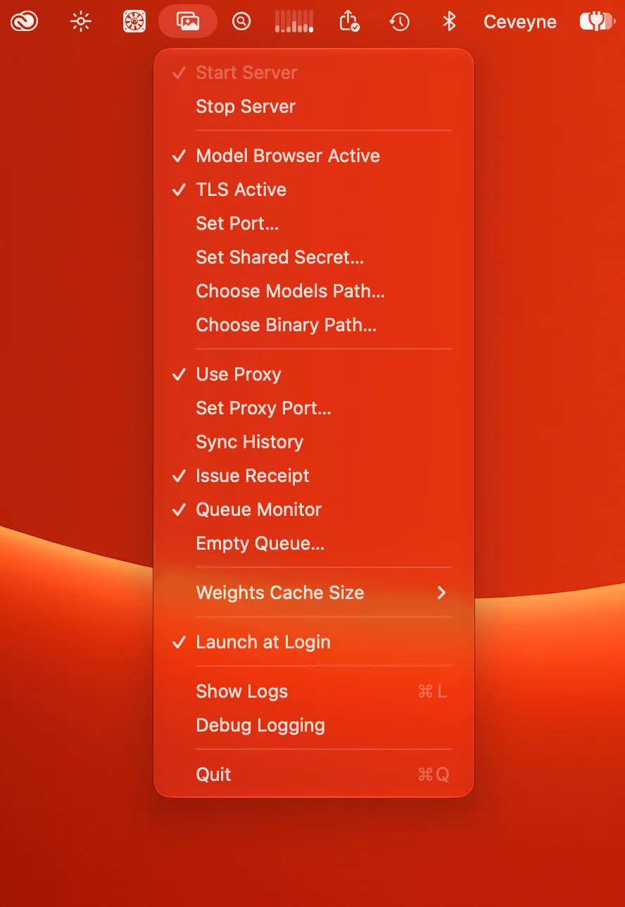

The built-in **gRPC Queue Monitor** allows for monitoring running or recently finished generations. This can be helpful when you use your gRPC server for several clients across your local network, or for generation tasks running in the background.

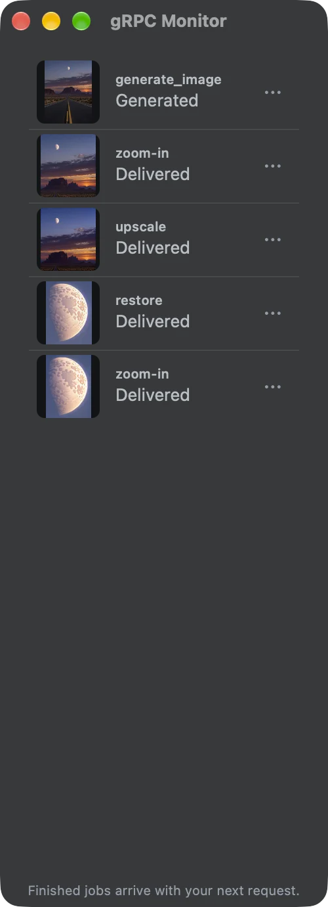

### gRPC Queue Monitor

**gRPC Queue Monitor** allows for reviewing, previewing, and canceling running jobs and lets you examine and save the generated images and videos.

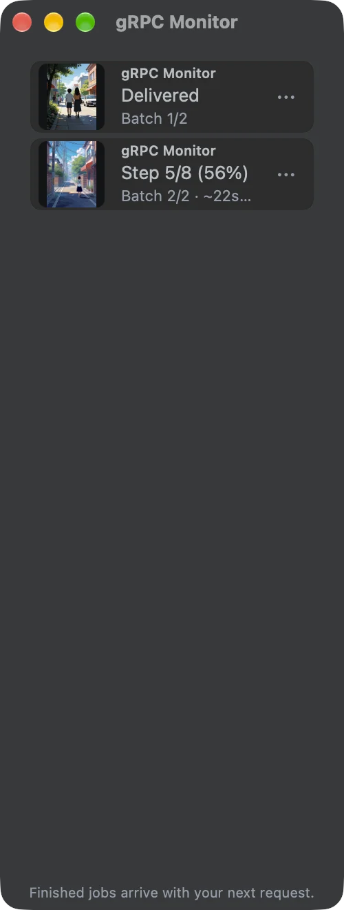 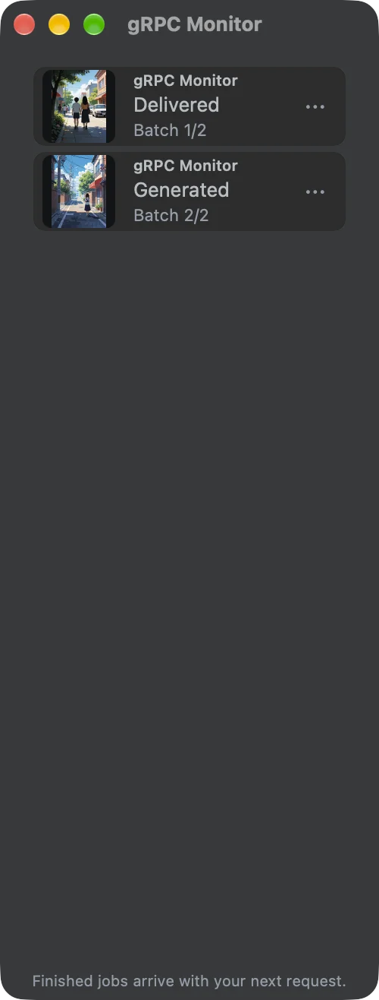 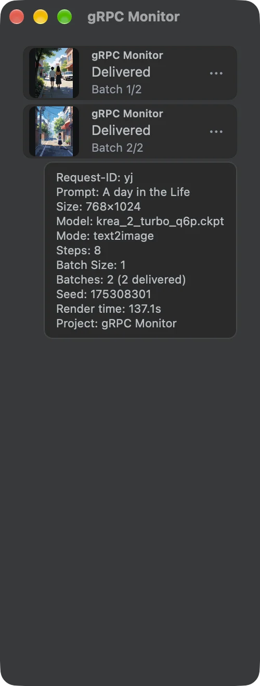  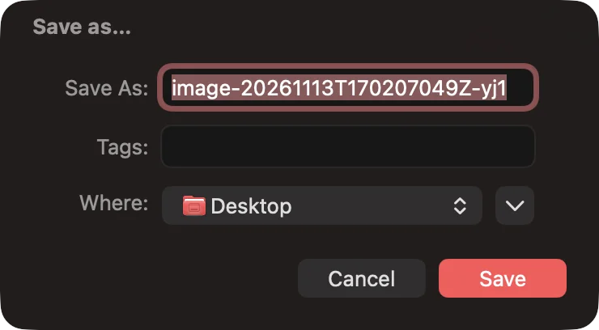

### Experimental – Draw Things App Support  
  
**gRPC Proxy** provides the technical base of the queue monitoring features – and adds an *experimental* feature. 👻  
  
Disclaimer: ☝️ I am fully aware that the app support presented below is only a sketch to investigate the benefits and feasibility in general. Without a real integration into the Draw Things app’s `Version History`, this remains a hack, which, however, shows that and how the feature could work.  
  
When connected from the Draw Things App (locally or from other devices across your local network), **gRPC Proxy** immediately releases the UI after scheduling a generation task by returning an image as a receipt. You can continue scheduling additional tasks and put them on the queue instead of watching the progress bar of your current render. Running or recently finished generations can still be observed from the **gRPC Queue Monitor**. Re-sending an already processed request updates you on all current tasks. Finished jobs arrive with your next request. The **gRPC Queue Monitor** optionally gives you a complete overview of all the different requests in the queue.   
  
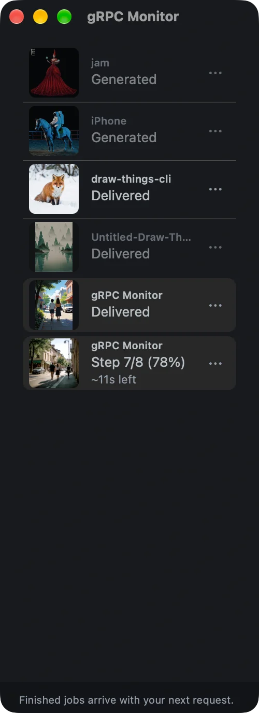  
  
Since we cannot provide a proper UI on Draw Things App for the queuing feature, you may use a combination of the receipt the proxy returns and a prompt to control a particular task (e.g. to cancel it). Receipts are adapted to the requesting client.  
  
### gRPC Proxy on iPhone  
  
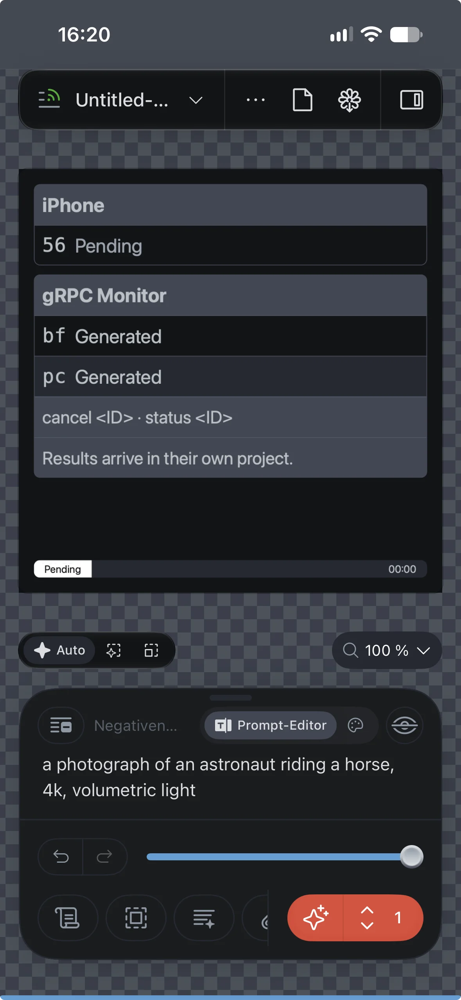 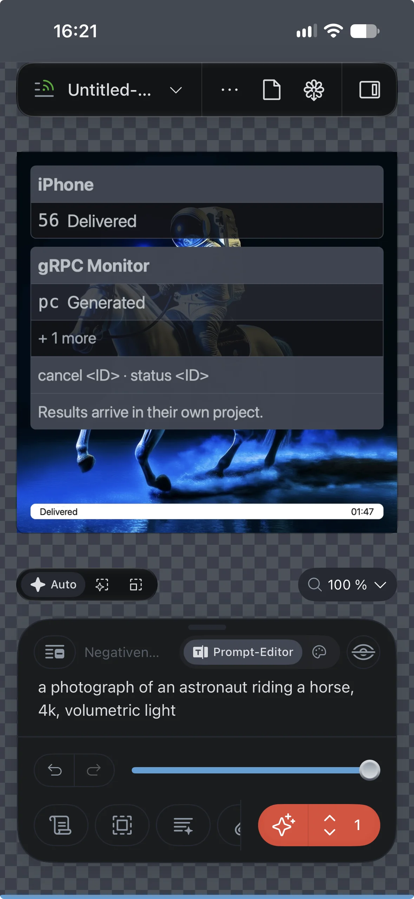 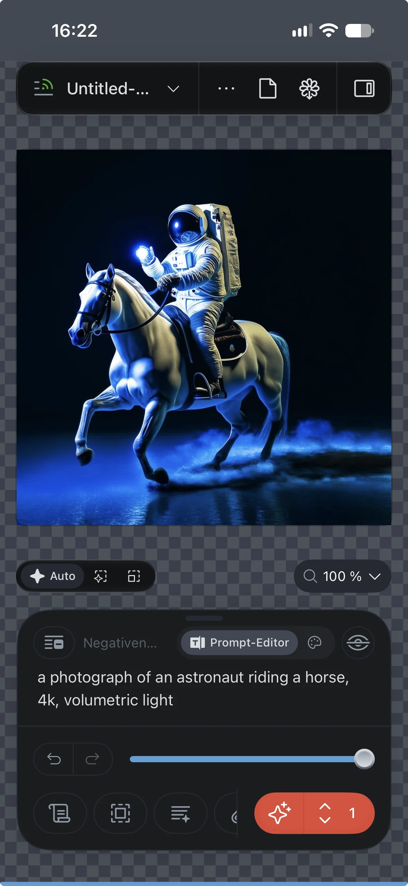  

### gRPC Proxy on Mac  
  
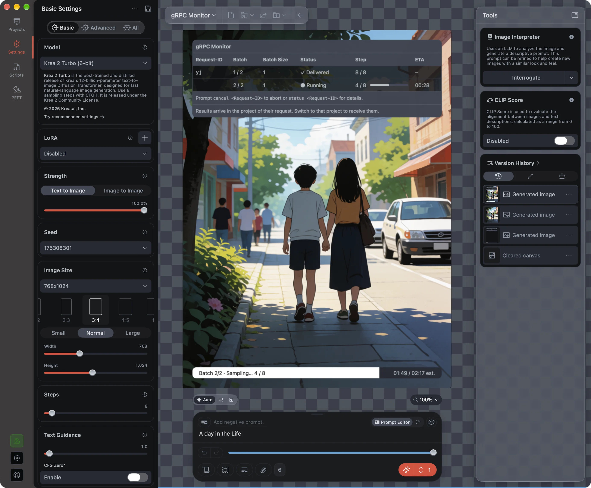

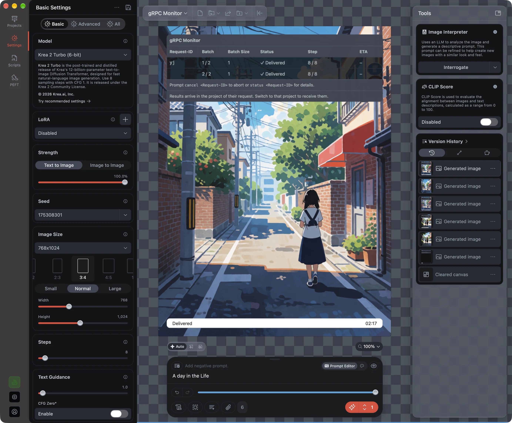

## Setup

### Step 1 — Install the gRPC server binary

Download the latest `gRPCServerCLI-macOS` from the [draw-things-community releases page](https://github.com/drawthingsai/draw-things-community/releases), then run:

```zsh
chmod 755 gRPCServerCLI-macOS
xattr -d com.apple.quarantine gRPCServerCLI-macOS
sudo chown root:wheel gRPCServerCLI-macOS
sudo mv gRPCServerCLI-macOS /usr/local/bin/
```

> **Why `sudo chown root:wheel`?**
> The server needs elevated permissions to bind to restricted ports. Setting the owner to `root` and using the setuid bit allows this without running the manager itself as root.

If you prefer a different location, move it there instead — you can point the app to any path in Settings via `Choose Binary Path…`.

### Step 2 — Install the [gRPC Server Manager](https://github.com/ceveyne/draw-things-community/releases)  
  
Download the latest `.dmg` from the [releases page](https://github.com/ceveyne/draw-things-community/releases), open the `.dmg`, drag **gRPC Server Manager** into /Applications, and launch it.

> 👀 The app appears as a menu bar icon (a photo symbol). There is no Dock icon.

### Step 3 — Configure Settings

Choose `Choose Models Path…` and optionally `Choose Binary Path…` to set the appropriate locations.  
  
If you just want to run the [gRPCServerCLI-macOS](https://github.com/drawthingsai/draw-things-community/releases), you’re ready to `Start Server`.  
  
To use the **gRPC Queue Monitor**, it’s required to set up and enable `Use Proxy`. `Queue Monitor` brings up the **gRPC Monitor** window.  
  
Configure your clients to use the configured gRPC **Proxy** Port (default: 7861) to monitor their generation.  
Configure your clients to use the configured gRPC **Server** Port (default: 7859) to purely use the original [gRPCServerCLI-macOS](https://github.com/drawthingsai/draw-things-community/releases).  
  
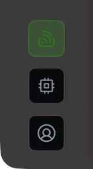  
  
The gRPC **proxy** is advertised as `<your_machine> (proxy) (<your_machine>. local.)`.  
The original gRPC **server** is advertised as `<your_machine> (<your_machine>. local.)`.  
  
Allow gRPC Server Manager to access your Draw Things project folder if you would like to try out the app integration.  
  
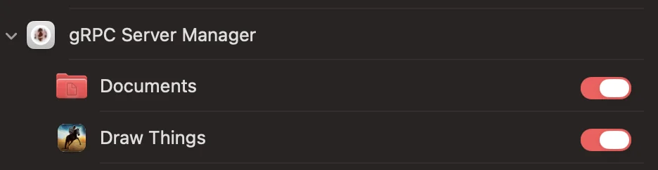

All settings are in the menu bar menu; see the [Settings Reference](#settings-reference) for every item, its default, and the check marks.


### Step 4 — Start the server

Click the menu bar icon → **Start Server**.

The icon changes to indicate the server is running. The tooltip shows current TLS and port status.

### Step 5 — View logs

Click the menu bar icon → **Show Logs** (or press `L` with the menu open).

A log window displays live output from the server process. Scroll to the bottom to follow new entries. Enable **Debug Logging** for verbose output (also written to `grpc-server-debug.log` in your models folder).

---

## Features

- Start/stop `gRPCServerCLI-macOS` as a managed child process
- Port conflict detection before launch
- Automatic cleanup of stale `image-*.bin` / `mask-*.bin` files (runs every 15 minutes)
- TLS toggle, shared secret, port, weights cache size, and path configuration — all persisted across restarts
- Launch at Login via macOS Login Items (System Settings → General → Login Items)
- Live log window with 200 KB rolling buffer

---

## Settings Reference

Click the menu bar icon to configure:

| Setting | Default | Description |
|---|---|---|
| **Binary Path** | `/usr/local/bin/gRPCServerCLI-macOS` | Path to the CLI binary from Step 1 |
| **Models Path** | `~/Library/Containers/com.liuliu.draw-things/Data/Documents/Models` | Your Draw Things models folder |
| **Port** | `7859` | TCP port the server listens on |
| **TLS** | On | Encrypted transport (recommended) |
| **Model Browser** | On | Exposes a model listing endpoint |
| **Shared Secret** | _(empty)_ | Optional authentication token |
| **Use Proxy** | Off | Also starts the background proxy (see below) |
| **Proxy Port** | `7861` | TCP port the app connects to when the proxy is used; must differ from the server port |
| **Sync History** | Off | Experimental, use with care: it writes into the project history (turning it on asks for confirmation; the dialog has Cancel preselected). Passes `--sync-history` to the proxy, which then rewrites the history entries of delivered images with the data of their own jobs (prompt, seed, …); otherwise `--no-sync-history`. Applies at the next proxy start (switch **Use Proxy** off and on) |
| **Issue Receipt** | Off (On when **Use Proxy** is turned on for the first time) | Passes `--issue-receipts` to the proxy. **Off** (formless): the laptop on this computer is served by the monitor mode and nothing is put into its history but the delivered images. **On**: the laptop on this computer is served as every other device is: a new order gets a receipt (a status image; a sound only for an order of several batches), every pickup of a running order is answered with the current status report (progress and preview), and a pickup of a finished order delivers the images followed by a delivery note (the closing status image). Nothing is deleted from the project in this mode. Applies at the next proxy start |
| **Weights Cache Size** | Disabled | VRAM reserved for model weights: Disabled / 8 / 16 / 24 / 32 GiB |
| **Launch at Login** | Off | Start the manager automatically on login |

**Check marks.** A check mark says what is on now and what is on again at the next start of the manager: every setting is remembered. **Start Server** and **Stop Server** are a pair, and one of them is always checked (a checked **Stop Server** means that nothing is started with the manager). **Queue Monitor** is checked while its window is open, and closing the window turns it off, as turning it off closes the window. With **Use Proxy** off, the other proxy items (Proxy Port, Sync History, Issue Receipt, Queue Monitor, Empty Queue) are dimmed; their check marks stay as they are.

**The first time Use Proxy is turned on**, the proxy is set up as follows: Proxy Port 7861, Sync History off, Issue Receipt on, and the Queue Monitor window opens (at the top right of the screen, as long as no position of it is remembered).

---

## Stopping the server

Click the menu bar icon → **Stop Server**, or quit the app via **Quit** (the server is stopped automatically on quit and on system shutdown/logout).

---

## Config considerations  
  
### gRPC server vs. gRPC proxy  
  
If you do not use the proxy or monitoring feature, connect your Clients to the gRPC server port and deactivate `Use Proxy`. This saves the memory of the proxy process (about 135 MB when idle, as shown by macOS; more while it handles generations).
  
If you do use the proxy or monitoring feature, connect your Clients ([draw-things-chat](https://lmstudio.ai/ceveyne/draw-things-chat) plugin, [generate-image](https://lmstudio.ai/ceveyne/generate-image) plugin & MCP server, [process-image](https://lmstudio.ai/ceveyne/process-image) plugin & MCP server, [Draw Things App](https://drawthings.ai), [draw-things-cli](https://github.com/drawthingsai/draw-things-community/releases), …) to the gRPC proxy port and activate `Use Proxy`.
  
All of our own [plugins & MCP servers](https://lmstudio.ai/ceveyne) are fully integrated with our **gRPC Manager, Monitor, and Proxy**. Hence, you may point them to the gRPC proxy port; no need to ever switch back. `runInBackground` is fully supported for both `true` and `false`.
  
Same with [draw-things-cli](https://github.com/drawthingsai/draw-things-community/releases). There is no behavioral change; all results from the original [gRPCServerCLI-macOS](https://github.com/drawthingsai/draw-things-community/releases) pass through the **gRPC Proxy** unchanged. By pointing the cli config to the proxy, you just receive queue monitoring as a goodie.
  
Third-party clients have not been tested yet, but are expected to receive all results from the original [gRPCServerCLI-macOS](https://github.com/drawthingsai/draw-things-community/releases) through the gRPC proxy unchanged (as long as they advertise themselves correctly and do not pretend to be the Draw Things app). By pointing their config to the proxy, you receive queue monitoring as a reward.
  
> For the Draw Things App (Desktop / Laptop, Mobile Device) the gRPC Proxy changes the behavior *substantially*. If you want to use gRPC queuing and monitoring, you must point the config to the **Proxy** Port (default: 7861). If you want to use the traditional direct generation, you must point the config to the **Server** Port (default: 7859).
  
### Issue Receipt  
  
On the desktop machine that runs the **gRPC proxy**, you can choose between `Issue Receipt` on or off.   
> 💡 It’s recommended to turn this `on` to get familiar with the proxy’s behavior.
  
Receipts are used internally to correctly identify the right job for status, cancellation, and delivery requests. So receipts are the best way to ensure the proxy is working as expected – even without using the **gRPC Queue Monitor**.

The downside is: As receipts appear in the Version History, you have to sweep them manually. 🧹
  
To avoid this, you may want to set `Issue Receipt` off. As receipts never appear in the Version History anymore, you have to fully rely on the gRPC Monitor to oversee what’s going on. This can be challenging, especially when running multiple requests from different projects.
  
### Sync History  
  
Generating traditionally ensures automatically that the results are stored with their respective metadata. Generating with **gRPC Proxy** allows you to queue multiple tasks from different clients and projects, which may easily end up in great chaos. Depending on `Batch Size`, `Batch Count`, and `Issue Receipt` on or off, it may be necessary to rewrite the Version History on delivery to keep everything aligned.
  
> ⚠️ Please be aware that enabling this is risky since it requires write access to your projects. We strongly recommend using only dedicated, newly created projects with that option. This experimental feature is for evaluation purposes only – it is not released for production.
  
## Conclusions  
  
**gRPC Manager, Queue Monitor, and Proxy** can be useful, and it does not touch your Draw Things projects when used with our [plugins & MCP servers](https://lmstudio.ai/ceveyne), draw-things-community’s [draw-things-cli](https://github.com/drawthingsai/draw-things-community/releases), and probably even all kinds of third-party gRPC clients. In these use cases, the writing operation is only for saving generated images or videos. This is operated independently from the client’s activities.
  
Using the gRPC Proxy for Draw Things App can only be a proof of concept. Our receipts can hardly work around the lack of a proper UI integration. `Sync History` is hard to avoid, but can be risky.
  
The **gRPC Proxy** implementation demonstrates the feasibility of unblocking the Draw Things App UI during generation. That can be helpful if you prefer to do other things than observing the progress bar during your latest generation. A proper app implementation could integrate the queue monitor into the `Version History`. Syncing the `Version History` may still be inevitable on delivery, but would have no different risk from writing results from unqueued generations if done internally.

---

## Troubleshooting

**Start Server has to be repeated**
The manager waits up to 20 seconds for the port to become free (for example right after a stop) and starts a process again, up to three attempts, when it exits within 10 seconds of the launch. The log windows show each wait and retry.

**"Port X is already in use"**
Another process is bound to that port. Either stop it, or choose a different port in Settings.

**Server binary not found**
Verify the binary path under **Choose Binary Path…** matches the actual location of `gRPCServerCLI-macOS`.

**Gatekeeper blocks the binary**
Make sure you ran the `xattr -d com.apple.quarantine` command from Step 1. The manager app itself is notarized and should open without any prompt.

**"Launch at Login" requires approval**
On macOS 13+, the system asks for permission the first time. Open **System Settings → General → Login Items** and confirm the entry is enabled.

---

## Building from source

No Xcode project is required. `build.sh` builds `gRPCServerProxy` (slim, arm64; the first build compiles the whole Draw Things stack and takes a while), builds the manager, puts the proxy into the app bundle and signs from the inside out. A Developer ID certificate is needed (`security find-identity -v -p codesigning`). An ad-hoc or unsigned build is pointless: macOS never lets an unsigned app access the data of a sandboxed app (here: Draw Things), and an ad-hoc signature is a new, unknown program with every build, so a permission granted in System Settings is lost again. The build scripts therefore refuse to run without `CODESIGN_IDENTITY`.

**Dev build (Developer ID signed, not notarized):**
```zsh
cd Apps/gRPCServerManager
CODESIGN_IDENTITY="Developer ID Application: Your Name (TEAMID)" ./build.sh
```

**Release build (hardened runtime, notarized, stapled, DMG and SHA-256):**
```zsh
cd Apps/gRPCServerManager
xcrun notarytool store-credentials grpc-notary   # once: Apple ID, app-specific password, team ID
RELEASE=1 VERSION_LABEL=0.1.0-rc1 \
CODESIGN_IDENTITY="Developer ID Application: Your Name (TEAMID)" \
NOTARY_PROFILE=grpc-notary \
./build.sh
```

Instead of `NOTARY_PROFILE`, `APPLE_ID`, `APPLE_APP_SPECIFIC_PASSWORD` (created at [appleid.apple.com](https://appleid.apple.com) under **Sign-In and Security → App-Specific Passwords**) and `APPLE_TEAM_ID` (10 characters, [developer.apple.com/account](https://developer.apple.com/account) under Membership) can be set. The result is `build/gRPC-Server-Manager-<VERSION_LABEL>-arm64.dmg` with its `.sha256`.
